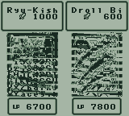
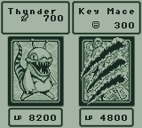

# Yu-Gi-Oh! Duel Monsters 1 — Early Days Collection Graphics Fix

## Summary

This ROM patch fixes all known graphics issues (stemming from changes in the graphics/animation loader) in the Early Days Collection version of Yu-Gi-Oh! Duel Monsters 1.
All languages included in EDC should be supported by this patch.

Use your favorite IPS patcher to patch the extracted ROM.

Do not apply to a retail Japanese ROM, only ROMs extracted from your own copy of Early Days Collection using [Cowabunga](https://github.com/Masquerade64/Cowabunga).

Before:  
  

After:  
  

---
# Technical Details

## How the DM1 Graphics Fix Works

This patch fixes graphics corruption in the *Yu-Gi-Oh! Duel Monsters 1* release included in *Yu-Gi-Oh! Early Days Collection*.
The problem was not simply that some graphics assets were missing or damaged. The Early Days Collection version had differences in its graphics-loading code compared with the original retail Game Boy Color release. Those differences affected both the loading of card graphics and the transfer of animated graphics into VRAM.
The fix restores the original retail behavior where necessary while retaining the existing card-art correction.

### 1. Card graphics and portrait corruption

During investigation, the portrait tile maps and their associated tile attributes were compared between the English Early Days Collection ROM and the Japanese reference.
The tile graphics themselves were not necessarily the problem. In particular, the portrait tile staging data at `$C3D0–$C3FB` was identical, while portions of the corresponding tile-map and attribute data differed.

One example was at `$9AC2`:

- The tile-map entry was `$A6` in both versions.
- The English attribute byte was `$FF`.
- The Japanese attribute byte was `$01`.

These attribute bytes control how the Game Boy Color displays a tile, including its VRAM tile-data bank, palette, and display flags. An incorrect attribute can therefore make an otherwise valid tile appear as corrupted graphics.
The original card-art correction addresses this part of the problem. It preserves the intended graphics data and display behavior rather than attempting to replace the affected artwork.

### 2. Animated graphics corruption

A separate issue affected attack animations and card-destruction animations.
The Early Days Collection version had modified the graphics-loading path in ROM bank `$14`. In particular, two regions differed from the original retail implementation:

| ROM offset | Purpose |
|---|---|
| `$38274` | Graphics-transfer implementation |
| `$38AAB` | Redirect into the modified transfer path |

The modified path did not behave like the original retail graphics-transfer implementation. This caused corruption when animated graphics were loaded, even though the same animations worked correctly in the original retail ROM.
The fix restores both affected regions to their original retail equivalents.
This is important because restoring only one of the two regions is insufficient: the transfer implementation and the code redirecting execution into it must agree.
Testing confirmed that restoring these two sections, while retaining the card-art correction and English graphics assets, fixed both attack-animation sprites and card-destruction sprites.

### 3. Why the patch restores code instead of replacing sprites

The underlying issue is in the graphics-loading process, not necessarily in the graphics themselves.
Replacing individual sprites would only conceal some of the symptoms. Restoring the original transfer behavior allows the game to load its existing graphics correctly.
The final fix therefore combines:

1. The original card-art correction.
2. Restoration of the retail graphics-transfer implementation at ROM offset `$38274`.
3. Restoration of the corresponding execution redirect at ROM offset `$38AAB`.

This preserves the original game assets while correcting the code responsible for loading them.

### 4. Compatibility and ROM handling

The patching work was extended beyond the English release. The patcher supports the English, Japanese, French, German, Italian, and Spanish ROM variants.
The patching process is designed to preserve the full 2 MiB ROM image rather than unnecessarily truncating it to 1 MiB. This is important for maintaining the original ROM layout and avoiding unrelated changes to data outside the affected regions.
The English release was tested in mGBA and MiSTer FPGA. The corrected version displays card artwork, attack-animation sprites, and card-destruction sprites without the corruption observed in the unpatched Early Days Collection release.

## AI Disclosure

This fix was developed with assistance from ChatGPT as assembly code is difficult for humans to parse in a timely manner.
